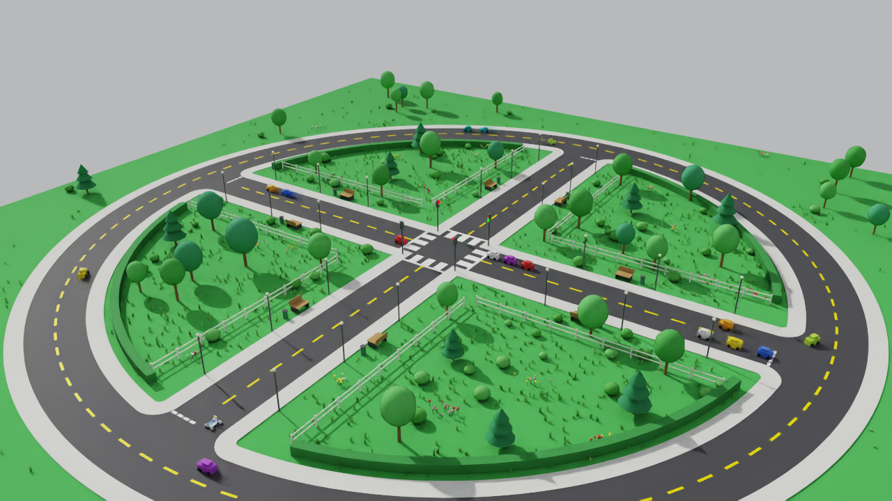
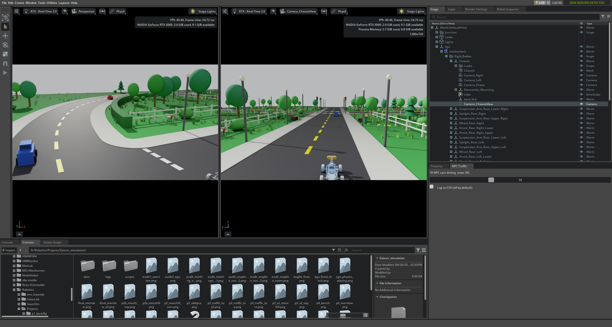
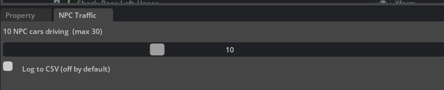

# Zaixen Isaac Sim

A small, repeatable traffic world built in NVIDIA Isaac Sim. A self-driving toy car drives through a junction with traffic lights and other cars, and shares its data over ROS 2. We use it to record normal driving and, later, attacks, so an AI agent can learn to spot abnormal behaviour.



## What is in the scene

- A road crossing with traffic lights, a ring road around it, lane paint, lamps, trees and fences.
- Up to 30 other cars that obey the lights and keep their distance. You choose how many with a slider.
- One ego car that stops on red, goes on green and slows down for cars ahead.
- The same run gives the same result every time.

## How it looks in Isaac Sim



The **NPC Traffic** panel (bottom right of the window) sets how many cars drive:



## Branches

| Branch | What it holds |
|---|---|
| `main` | The scene, scripts and docs (this branch) |
| `ai-team-data` | `main` plus `AI_team_data/`: recorded driving data for the AI team, with its own README. Versions are tags, e.g. `dataset-v1-normal` |

## Folders

```
zaixen_scene.usd   the scene
scripts/           simulation code and scene build scripts
ros_bridge/        ROS 2 setup and recording helpers
logs/              example log and scene check report
docs/              technical README, report, beginner guide, images
```

## Quick start

1. Install Isaac Sim 6.0.1 on Windows (an NVIDIA GPU is needed).
2. Open `zaixen_scene.usd`.
3. Open `scripts/run_simulation.py` in the Script Editor and run it.
4. Press **Play**. Press **Stop** to reset.

For ROS 2 (WSL2) setup, see [`ros_bridge/`](ros_bridge/). For the full details, see [`docs/TECHNICAL_README.md`](docs/TECHNICAL_README.md).

## Status

The scene and the ego car are done. ROS 2 data is flowing and normal-driving data has been recorded. Attack injection and the defence agent are planned.

## Notes

- This is for defensive research. Attacks run only against this simulation, on an isolated ROS 2 network.
- The ego car model is NVIDIA's Leatherback. It is loaded from NVIDIA's servers and is not included here.

## Licence

MIT. See [LICENSE](LICENSE).
